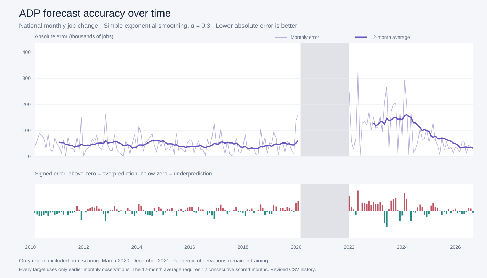

# ADP National Employment Forecaster

Explore historical U.S. private-sector employment and forecast the next month via the dashboard. 
## How to run the project

### Requirements

- Git and access to this repository (it is currently private).
- Python **3.10 or newer**.
- A modern web browser.


### Clone and start

```sh
git clone https://github.com/dianelin330/pinwheel-take-home.git
cd pinwheel-take-home
```

On macOS or Linux:

```sh
python3 --version  # should return 3.10 or newer
python3 server.py
```

Then, open **http://127.0.0.1:8001/** in your browser. 


The chart defaults to the last five years. Use the toggles on the left to explore the data. The forecast is the most recent data point, on the far right. The forecast is fixed and will not change with applied filters.

### Run tests

On macOS or Linux:

```sh
python3 -m unittest discover -s tests -v
```

## Approach

### Simple exponential smoothing

The model starts with the first observed monthly **change** (next month employment - current month) and updates its estimate as follows:

```text
smoothed_change[t] = alpha * change[t]
                   + (1 - alpha) * smoothed_change[t-1]

predicted_change[t+1] = smoothed_change[t]
predicted_employment[t+1] = employment[t] + predicted_change[t+1]
```

The current smoothing weight is `alpha = 0.8`, selected for the lowest historical MAE among the tested weights. Each update weights the latest change at 80% and the previous smoothed estimate at 20%. Older changes therefore have progressively less influence. All available monthly observations were used. Alpha is configurable in the backend.

We chose this approach because it is transparent, inexpensive to run, and easy to explain directly from the calculation. It balances responsiveness to recent hiring with smoothing of month-to-month noise.

Other approaches considered:

- **Repeat the previous change:** easy to explain, but lets one unusual month determine the entire forecast.
- **Seasonal exponential smoothing:** could capture calendar effects, but ADP already seasonally adjusts the selected series.
- **More complex machine learning:** increases tuning and explanation costs with only 201 monthly observations per series in the supplied snapshot.

Choosing simplicity is a design tradeoff, not a claim that smoothing has been shown to outperform those alternatives.

## Key Tradeoffs

### Leave weekly data out of the forecaster

The forecast target is monthly. Higher-frequency observations do not automatically provide a better prediction. In this snapshot, monthly observations extend through September 2026, while weekly observations end on August 15, 2026. Those weekly observations are older than the latest monthly input.

## How you evaluated forecast accuracy and what the results were

We tested the original fixed smoothing weight, `alpha = 0.3` and found the following accuracy levels in the graphs below. The test was for every target month, the model used only preceding monthly observations, predicted the next net job change, and compared it with the actual change in the CSV (March 2020–December 2021 was excluded from scoring accuracy.

The primary metric is **mean absolute error (MAE), measured in jobs**. Lower is better. 



The upper graph shows each month's absolute error and its trailing 12-month average. The lower graph shows signed errors. The grey region marks the excluded pandemic period. The rolling average requires 12 consecutive scored months, so it is also absent immediately after the excluded period.

| Forecast period | Average absolute error | Scored months |
|---|---:|---:|
| 2010–2014 | 49,303 jobs | 58 |
| 2015–2019 | 41,279 jobs | 60 |
| 2022–2023 | 135,941 jobs | 24 |
| 2024 | 98,235 jobs | 12 |
| 2025 | 50,680 jobs | 12 |
| January–September 2026 | **34,740 jobs** | 9 |

Initially we were just looking for a decrease in the average absolute error (meaning the model improved in predictive abilities). Later, however, we realized we could run this experience with other weights.
### Smoothing-weight experiment

We compared 11 fixed smoothing weights using the same params as above. All values below are errors in jobs.

| Alpha | Overall MAE | Overall RMSE | MAE before 2024 | MAE Jan 2024–Sep 2026 |
|---|---:|---:|---:|---:|
| 0.05 | 86,029 | 120,658 | 86,039 | 85,985 |
| 0.1 | 73,471 | 99,342 | 74,115 | 70,661 |
| 0.2 | 65,428 | 86,316 | 65,695 | 64,260 |
| 0.3 | 62,124 | 84,107 | 61,780 | 63,625 |
| 0.4 | 60,417 | 83,731 | 59,598 | 63,989 |
| 0.5 | 58,944 | 83,800 | 57,910 | 63,454 |
| 0.6 | 57,726 | 84,012 | 56,626 | 62,524 |
| 0.7 | 56,873 | 84,326 | 55,984 | 60,756 |
| 0.8 | 56,625 | 84,788 | 55,924 | 59,683 |
| 0.9 | 57,009 | 85,482 | 56,377 | 59,765 |
| 1 | 57,548 | 86,515 | 56,958 | 60,121 |

**Alpha 0.8 had the lowest overall MAE among the tested values:** 56,625 jobs, versus 62,124 at the original alpha 0.3 (an 8.9% reduction). Thus it reduced typical absolute misses but did not improve the squared-error measure that emphasizes large misses. 

**Due to these results, the application now uses alpha 0.8, which is the optimal weight for the most accurate predictive results**.

## What you'd build next if you had another week

1. If next month's prediction is released, we could evaluate the accuracy of our smoothing weight.
2. The ability for the user to toggle their own smoothing weight and rerun the forecast rather than hardcoding it in the backend.
3. Rather than using the current downloaded CSV, pull the data from the ADP site directly. Update as needed.
